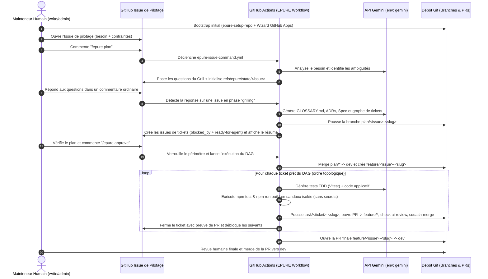

# Guide Utilisateur du Flux EPURE (`Giskard-AI/epure`)

Ce document décrit le flux complet d'utilisation d'**EPURE** (*Engineered Planning, Unified Review & Execution* / *Élaboration de Plans, Usinage, Revue et Exécution*) du point de vue d'un **mainteneur ou contributeur humain**.

Dans un dépôt configuré avec EPURE, **l'humain n'écrit ni le code applicatif, ni les branches `plan/*`, `feature/*` ou `task/*`, ni les tickets d'implémentation à la main**. Tout le cycle de développement est piloté depuis les **GitHub Issues** et les **Pull Requests** via les commandes `/epure`.

---

## 1. Vue d'ensemble du cycle de vie



---

## 2. Prérequis et Bootstrap initial (`setup-repo`)

### 2.1. Secrets et Environnements GitHub requis sur le dépôt consommateur
1. **Environnement `gemini`** :
   - Secret `LLM_API_KEY` : clé API Gemini utilisée par le proxy LLM de sandbox.
2. **Secrets de l'Agent App** (au niveau dépôt ou organisation) :
   - `EPURE_AGENT_APP_ID` : identifiant numérique de la GitHub App de développement (`<owner>-epure-agent`).
   - `EPURE_AGENT_APP_PRIVATE_KEY` : clé privée PEM de l'Agent App (permissions : `contents: write`, `issues: write`, `pull_requests: write`, `checks: write`).
3. **Environnement `release`** (protégé par reviewers) :
   - `EPURE_RELEASE_APP_ID` et `EPURE_RELEASE_APP_PRIVATE_KEY` pour la promotion fast-forward `dev → main`.

> Pour créer et configurer les deux GitHub Apps de manière guidée, exécutez le wizard interactif :
> ```bash
> ./scripts/setup-github-apps-wizard.sh
> ```

### 2.2. Initialisation des workflows appelants et de `.github/agents.yml`
Depuis la racine du dépôt consommateur, exécutez la CLI `epure-setup-repo` issue de la release publique `Giskard-AI/epure` :

```bash
# 1. Simulation sans modification (--dry-run)
node setup-repo.mjs --repo <owner>/<repo> --repo-root . --pinned-sha <40-char-sha> --dry-run

# 2. Application effective (--apply)
node setup-repo.mjs --repo <owner>/<repo> --repo-root . --pinned-sha <40-char-sha> --apply
```

Cela génère :
- `.github/agents.yml` (modèles, limites opérationnelles Q78, invariants de sécurité).
- `.github/workflows/epure-issue-command.yml` (écoute `issue_comment` et appelle `Giskard-AI/epure/.github/workflows/issue-command.yml@<sha>`).
- `.github/workflows/epure-check.yml` (vérifie le contrat EPURE sur les Pull Requests).
- `.github/workflows/release.yml` (promotion contrôlée `dev → main`).

Commitez et poussez ces fichiers sur `main` et `dev`.

---

## 3. Référence des commandes `/epure` dans les Issues GitHub

Seuls les utilisateurs disposant de la permission GitHub **effective `write` ou `admin`** sur le dépôt peuvent déclencher ces commandes. Les commentaires de bots (`*[bot]`) sont systématiquement ignorés pour prévenir toute boucle.

| Commande ou Action Humaine | Phase | Effet déclenché par GitHub Actions (`EPURE`) |
| :--- | :--- | :--- |
| **`/epure status`** | Toutes | Lit la référence `refs/epure/state/<issue>` et poste un commentaire récapitulant la phase, le statut, la branche active et le curseur de commentaires. |
| **`/epure plan`** | Cadrage | Initialise `refs/epure/state/<issue>` en phase `grilling`, analyse le corps de l'issue avec Gemini et poste les questions de clarification structurées (`❓ Q1...`). |
| **Réponse humaine (sans commande slash)** | `grilling` | Dès que l'issue est en phase `grilling`, toute réponse humaine est lue en lot depuis `last_processed_comment_id`. Si toutes les questions sont tranchées, EPURE génère automatiquement sur `plan/<issue>-<slug>` : `GLOSSARY.md`, `docs/adr/0001-*.md`..`NNNN-*.md`, `docs/specs/<slug>.md`, et crée les issues de tickets GitHub avec `blocked_by` et le label `ready-for-agent`. |
| **`/epure to-spec`** | `grilling` | Force explicitement la génération/mise à jour de `GLOSSARY.md`, des ADRs et de `docs/specs/<slug>.md` sur `plan/<issue>-<slug>`. |
| **`/epure to-tickets`** | `spec` | Force explicitement le découpage de la spécification en issues de tickets GitHub avec `blocked_by` et `ready-for-agent`. |
| **`/epure approve`** | `awaiting_human_approval` | Verrouille le périmètre (`spec_sha`), fusionne `plan/<issue>-<slug>` dans `dev`, crée `feature/<issue>-<slug>`, exécute séquentiellement chaque ticket du DAG en TDD sur `task/<ticket>-<slug>`, ouvre et fusionne les PRs de tâches après vérification CI/review IA, ferme les tickets, puis ouvre la PR finale `feature/<issue>-<slug> → dev`. |
| **`/epure cancel`** | Toutes | Passe immédiatement l'état du plan à `cancelled` dans `refs/epure/state/<issue>`, empêchant toute nouvelle exécution ou intégration automatique tout en conservant l'historique pour audit. |

---

## 4. Parcours pas-à-pas d'un utilisateur humain

### Étape A — Ouvrir l'issue de pilotage
L'humain ouvre une issue sur GitHub décrivant la fonctionnalité souhaitée, les règles métier, les formules éventuelles et les contraintes techniques :

```bash
gh issue create -R <owner>/<repo> \
  --title "[Plan] Titre de la fonctionnalité" \
  --body-file cahier-des-charges.md
```

### Étape B — Lancer la planification (`/epure plan`)
L'humain poste le commentaire `/epure plan` sur l'issue :

```bash
gh issue comment <issue_number> -R <owner>/<repo> --body "/epure plan"
```

Le workflow GitHub Actions `EPURE Issue Command Gate` se déclenche :
1. Vérifie que l'auteur possède la permission `write` ou `admin`.
2. Initialise `refs/epure/state/<issue_number>` (`phase: grilling`, `status: active`).
3. Appelle Gemini et poste un commentaire contenant les questions de cadrage (`❓ Q1`, `❓ Q2`, etc.) avec ses recommandations (`➡️`).

### Étape C — Répondre au Grill et inspecter le Plan généré
L'humain répond directement dans l'issue par un commentaire normal (ex: validation des recommandations ou précisions métier) :

```bash
gh issue comment <issue_number> -R <owner>/<repo> --body "Q1: Oui, je valide la recommandation. Q2: Oui..."
```

Le workflow GitHub Actions se déclenche automatiquement sur ce nouveau commentaire :
1. Consomme les nouveaux commentaires depuis `last_processed_comment_id`.
2. Génère et pousse sur la branche `plan/<issue_number>-<slug>` :
   - `GLOSSARY.md`
   - `docs/adr/0001-*.md` ...
   - `docs/specs/<slug>.md`
3. Crée sur GitHub les issues correspondant aux **tickets d'implémentation** (avec `blocked_by: #<id>` et le label `ready-for-agent`).
4. Passe l'état à `awaiting_human_approval` et poste dans l'issue de pilotage le récapitulatif de la spec et la liste des tickets créés.

### Étape D — Approuver le plan (`/epure approve`)
Après avoir vérifié la spec et les tickets, l'humain donne son feu vert :

```bash
gh issue comment <issue_number> -R <owner>/<repo> --body "/epure approve"
```

Le workflow GitHub Actions exécute alors la boucle d'implémentation autonome :
1. Intègre la documentation de `plan/<issue_number>-<slug>` sur `dev`.
2. Crée la branche de fonctionnalité `feature/<issue_number>-<slug>` depuis `dev`.
3. Pour chaque ticket débloqué du graphe :
   - Crée la branche `task/<ticket_number>-<slug>`.
   - Génère les tests unitaires Vitest et le code applicatif via Gemini.
   - Exécute les tests et le build dans la sandbox isolée (sans accès aux secrets).
   - Pousse `task/<ticket_number>-<slug>`, ouvre la Pull Request vers `feature/<issue_number>-<slug>`, publie le check `ai-review`, fusionne la PR en squash et ferme le ticket GitHub.
4. Une fois tous les tickets terminés, ouvre la Pull Request finale `feature/<issue_number>-<slug> → dev` et poste le lien dans l'issue de pilotage.

### Étape E — Validation humaine finale
Conformément à la gouvernance EPURE (Q45, ADR-0011), aucun agent ne fusionne automatiquement dans `dev`. L'humain examine la Pull Request `feature/* → dev`, vérifie les checks CI et la fusionne dans `dev`.
